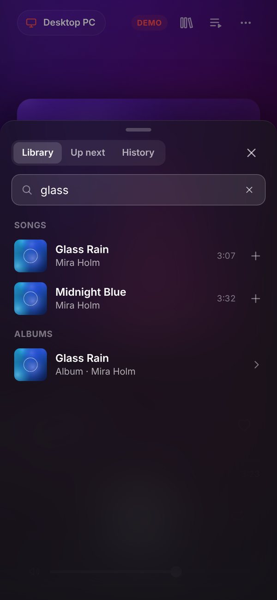
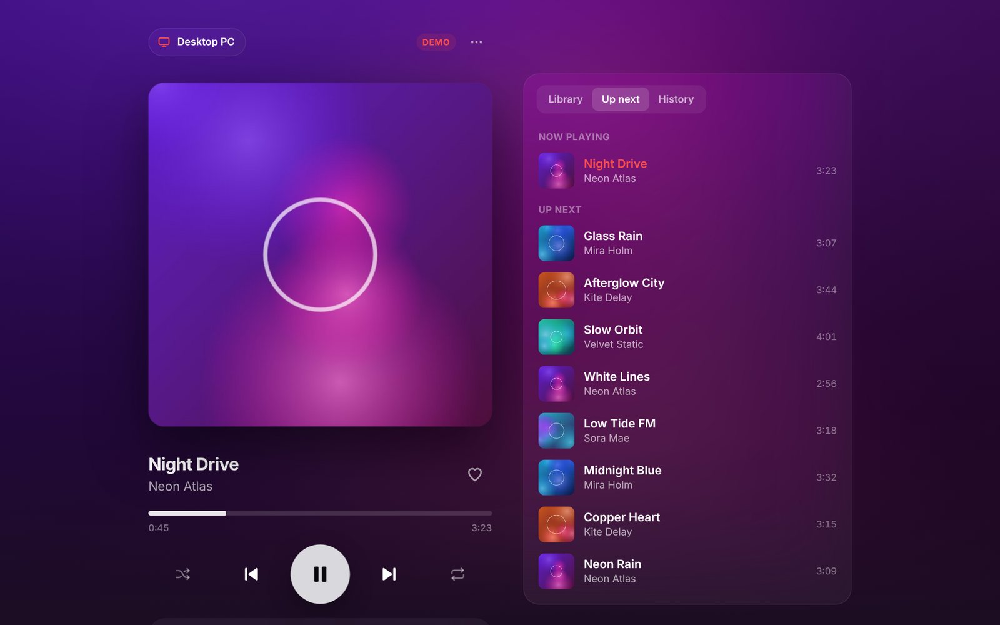
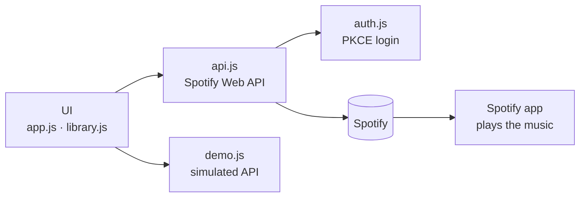

# Nachklang

**A Spotify remote control in the Liner look: an installable web app (PWA) for iPhone, Android and desktop.**
Built on the Spotify Web API with a glassy, cover-tinted interface. No framework, no build step, no backend.

**Live:** https://ssh4d0ww.github.io/nachklang/ (tap “Try the demo” to use it without a Spotify account)

<p>
  
  
  
  
</p>



<sub>Screenshots from demo mode: titles, artists and covers are made up.</sub>

## What it is

The official Spotify app can't be restyled on a phone. Nachklang is a separate interface that remote-controls Spotify: the music keeps playing in the Spotify app (on your phone, computer or speaker), and Nachklang shows and controls it with a calmer design. The look is inspired by the Liner desktop app: glass surfaces, the blurred cover as background, and a base color computed from the cover.

## Features

- **Player:** large cover, play/pause, previous/next, seek by dragging, shuffle, repeat (off / all / one), volume
- **Swipe:** swipe the cover left for the next track, right for the previous one
- **Pause and resume:** after pausing, the last track stays on screen and resumes at the same position, even when Spotify has gone idle
- **Library:** browse and play Liked Songs, your playlists and saved albums, including shuffle
- **Search:** songs, artists, albums and playlists; artist pages with albums and singles
- **Queue:** see what's up next and add tracks (+), plus a history of recently played tracks
- **Devices:** move playback between phone, computer and speakers (Spotify Connect)
- **Liked Songs:** save and remove tracks with the heart
- **Installable:** runs full screen from the home screen, and the app shell works offline
- **Demo mode:** fully usable without a Spotify account
- **Responsive:** bottom sheets on phones, two columns on large screens

## Tech

| Area | Approach |
|---|---|
| UI | HTML, CSS, JavaScript (ES modules), no libraries |
| Login | OAuth 2.0 Authorization Code with PKCE in the browser, automatic token refresh |
| Data | Spotify Web API; playback state is polled every 2 s and progress advances locally in between |
| Interaction | optimistic updates: actions show immediately and are reconciled with Spotify afterwards |
| Offline | service worker with “network first, cache as fallback”, so updates arrive immediately |
| Hosting | GitHub Pages |



**Some decisions in detail:**

- **No framework, no build step:** the project stays small, loads fast and runs straight from GitHub Pages.
- **Demo mode with the same data format:** `demo.js` returns objects shaped like the real API. The UI can't tell the difference, so everything can be tested without an account.
- **Handles the February 2026 Spotify API changes:** playlist contents come from `/playlists/{id}/items`, Liked Songs are saved via `/me/library`, and search returns at most 10 results per type. Spotify no longer shows the contents of playlists you don't own; Nachklang explains this and still plays them.
- **Resuming after a pause:** on iPhone, Spotify reports “nothing active” shortly after pausing. Nachklang remembers the last track, position and context and resumes on the same device; if that device is asleep, it offers the device picker and a link to open Spotify.
- **iOS details:** safe areas (notch, home indicator), separate storage for Safari and home screen apps, and a fallback for the empty strip iOS 26 leaves at the bottom of web apps.

## Project structure

```
index.html            page structure
css/app.css           styles (glass, sheets, phone and desktop layouts)
js/app.js             state, player, devices, queue, swipe gestures, resume
js/library.js         library, playlists, albums, artists, search
js/api.js             Spotify Web API (only the endpoints needed)
js/auth.js            PKCE login, storing and refreshing tokens
js/demo.js            simulation for demo mode
js/color.js           base color from the cover
js/icons.js           custom line icons
js/store.js           storage with a fallback when localStorage is blocked
js/config.js          Client ID, Redirect URI, scopes
sw.js                 service worker
manifest.webmanifest  app name, icons, full screen
```

## Run it yourself

1. **Create a Spotify app:** go to developer.spotify.com/dashboard → “Create app” and choose the **Web API**.
2. **Add a Redirect URI:** exactly the address Nachklang runs at, with a trailing `/`, e.g. `https://YOURNAME.github.io/nachklang/`. Locally `http://127.0.0.1:8080/` works; Spotify does not allow `localhost`.
3. **Client ID:** copy it from the dashboard and paste it on first start, or set it in `js/config.js`. No client secret is needed.
4. **Development mode:** the app owner needs Spotify Premium. Up to five more people can be added in the dashboard under “User Management”.

**Run locally:**

```
python -m http.server 8080 --bind 127.0.0.1
```

**On iPhone:** open the address in Safari → Share → “Add to Home Screen”. Then log in inside the installed app.

## Limitations

- Controlling playback requires Spotify Premium.
- Tracks in the queue can't be jumped to or removed; there is no endpoint for that.
- Some devices, such as iPhones, don't allow remote volume control.
- When iOS fully suspends the Spotify app after a long pause, nothing can wake it remotely; open Spotify briefly and resume from Nachklang.
- Nachklang does not play audio itself; it is the remote.

## Ideas

- TypeScript and automated tests (e.g. Vitest), checks with GitHub Actions
- Lyrics view and animations when the track changes
- More gestures, e.g. long-press a track for more options

---

Built with help from Claude (Anthropic). A personal learning project, not affiliated with Spotify or Liner. License: [MIT](LICENSE).
