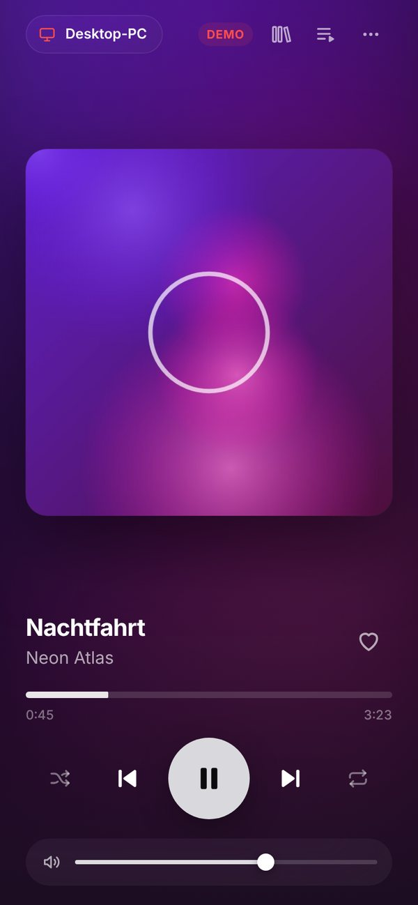
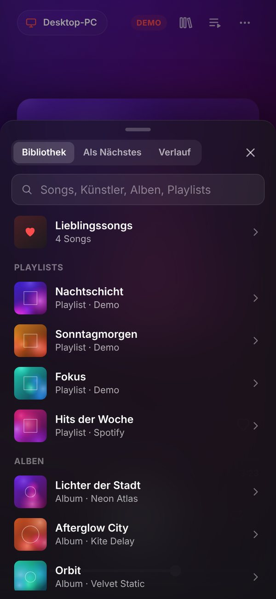
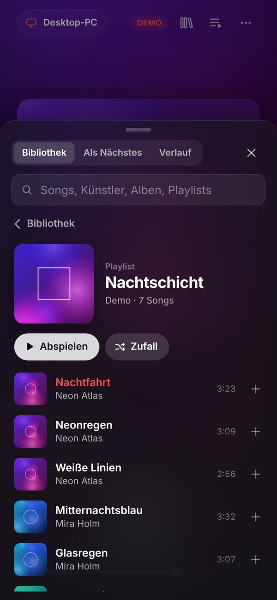
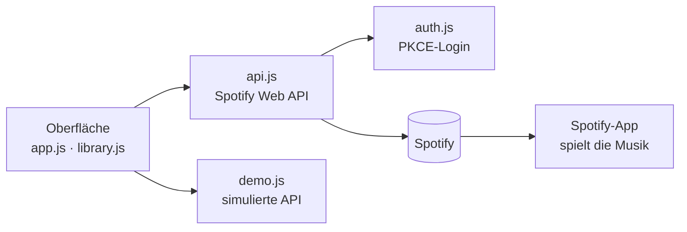

# Nachklang

**Spotify-Fernbedienung im Liner-Look: eine installierbare Web-App (PWA) fürs iPhone, für Android und den PC.**
*A Spotify remote control web app (PWA) with a glassy, cover-tinted UI, built on the Spotify Web API. No framework, no build step, no backend.*

**Live:** https://ssh4d0ww.github.io/nachklang/ (mit „Demo ansehen“ auch ohne Spotify-Konto ausprobierbar)

<p>
  
  
  
  
</p>


<sub>Screenshots aus dem Demo-Modus: Titel, Künstler und Cover sind erfunden.</sub>

## Worum es geht

Die offizielle Spotify-App lässt sich auf dem Handy nicht umgestalten. Nachklang ist deshalb eine eigene Oberfläche, die Spotify fernsteuert: Die Musik läuft weiter in der Spotify-App (am Handy, PC oder Lautsprecher), Nachklang zeigt und steuert sie in einem ruhigeren Design. Das Design ist von der Liner-Desktop-App inspiriert: Glasflächen, das Cover unscharf als Hintergrund und eine aus dem Cover berechnete Grundfarbe.

## Funktionen

- **Player:** großes Cover, Play/Pause, vor/zurück, Spulen durch Ziehen, Zufall, Wiederholen (aus / alles / ein Lied), Lautstärke
- **Wischen:** Cover nach links wischen = nächstes Lied, nach rechts = vorheriges
- **Bibliothek:** Lieblingssongs, eigene Playlists und gespeicherte Alben durchblättern und abspielen, auch per Zufall
- **Suche:** Songs, Künstler, Alben und Playlists; Künstlerseite mit Alben und Singles
- **Warteschlange:** anzeigen und Lieder hinzufügen (+), dazu der Verlauf der zuletzt gehörten Lieder
- **Geräte:** Wiedergabe zwischen Handy, PC und Lautsprechern wechseln (Spotify Connect)
- **Lieblingssongs:** Herz zum Speichern und Entfernen
- **Installierbar:** läuft vom Home-Bildschirm aus im Vollbild, die App-Hülle funktioniert auch offline
- **Demo-Modus:** komplett bedienbar ohne Spotify-Konto
- **Responsiv:** am Handy Sheets von unten, am großen Bildschirm zweispaltig

## Technik

| Bereich | Umsetzung |
|---|---|
| Oberfläche | HTML, CSS, JavaScript (ES-Module), keine Bibliotheken |
| Login | OAuth 2.0 Authorization Code mit PKCE direkt im Browser, Token-Erneuerung automatisch |
| Daten | Spotify Web API; Status alle 2 s abfragen, dazwischen läuft der Fortschritt lokal weiter |
| Bedienung | optimistische Updates: Aktionen sofort anzeigen, danach mit Spotify abgleichen |
| Offline | Service Worker mit „Netz zuerst, sonst Cache“, damit Updates sofort ankommen |
| Hosting | GitHub Pages |



**Ein paar Entscheidungen im Detail:**

- **Kein Framework, kein Build-Schritt:** Das Projekt bleibt klein, lädt schnell und läuft direkt von GitHub Pages.
- **Demo-Modus mit demselben Datenformat:** `demo.js` liefert Objekte wie die echte API. Die Oberfläche merkt keinen Unterschied, und alles lässt sich ohne Konto testen.
- **API-Änderungen von Februar 2026 berücksichtigt:** Playlist-Inhalte kommen über `/playlists/{id}/items`, Lieblingssongs werden über `/me/library` gespeichert, die Suche liefert höchstens 10 Treffer pro Typ. Fremde Playlists zeigt Spotify nicht mehr im Detail; Nachklang erklärt das und spielt sie trotzdem ab.
- **iOS-Eigenheiten:** sichere Bereiche (Notch, Home-Strich), getrennter Speicher zwischen Safari und Home-Bildschirm-App, und ein Rückfall für den freien Streifen unten, den iOS 26 in Web-Apps lässt.

## Aufbau

```
index.html            Aufbau der Seite
css/app.css           Design (Glas, Sheets, Layout für Handy und PC)
js/app.js             Zustand, Player, Geräte, Warteschlange, Wischgesten
js/library.js         Bibliothek, Playlists, Alben, Künstler, Suche
js/api.js             Spotify Web API (nur die benötigten Endpunkte)
js/auth.js            Login mit PKCE, Token speichern und erneuern
js/demo.js            Simulation für den Demo-Modus
js/color.js           Grundfarbe aus dem Cover
js/icons.js           eigene Linien-Icons
js/store.js           Speicher mit Rückfall, wenn localStorage gesperrt ist
js/config.js          Client ID, Redirect URI, Berechtigungen
sw.js                 Service Worker
manifest.webmanifest  App-Name, Icons, Vollbild
```

## Selbst einrichten

1. **Spotify-App anlegen:** Auf developer.spotify.com/dashboard → „Create app“, als API die **Web API** wählen.
2. **Redirect URI eintragen:** Das ist genau die Adresse, unter der Nachklang läuft, mit `/` am Ende, zum Beispiel `https://DEINNAME.github.io/nachklang/`. Lokal geht `http://127.0.0.1:8080/`; `localhost` lässt Spotify nicht zu.
3. **Client ID:** Aus dem Dashboard kopieren und beim ersten Start einfügen, oder fest in `js/config.js` eintragen. Ein Client Secret ist nicht nötig.
4. **Entwicklungsmodus:** Der App-Besitzer braucht Spotify Premium. Bis zu fünf weitere Personen lassen sich im Dashboard unter „User Management“ freischalten.

**Lokal starten:**

```
python -m http.server 8080 --bind 127.0.0.1
```

**Aufs iPhone:** Die Adresse in Safari öffnen → Teilen → „Zum Home-Bildschirm“. Danach in der installierten App einloggen.

## Grenzen

- Steuern geht nur mit Spotify Premium.
- Lieder in der Warteschlange lassen sich nicht direkt anspringen oder entfernen, dafür gibt es keinen Endpunkt.
- Manche Geräte, zum Beispiel iPhones, erlauben keine Lautstärke von außen.
- Nachklang spielt selbst keine Musik ab, es ist die Fernbedienung.

## Nächste Ideen

- TypeScript und automatische Tests (z. B. Vitest), Prüfung mit GitHub Actions
- Songtext-Ansicht und Animationen beim Liedwechsel
- Mehr Gesten, z. B. langes Drücken auf ein Lied für weitere Optionen

---

Entstanden in Zusammenarbeit mit Claude (Anthropic). Privates Lernprojekt, nicht mit Spotify oder Liner verbunden. Lizenz: [MIT](LICENSE).
